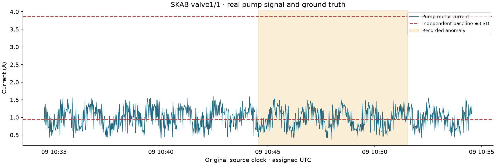
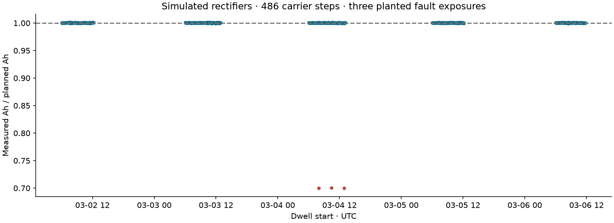
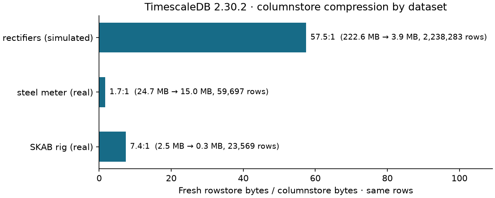

# Industrial IoT Historian & Energy Analytics

An OPC UA replay server and collector feed real sensor recordings into TimescaleDB. SQL integrates simulated rectifier current into carrier charge, scores excursions against real anomaly labels, and supplies a provisioned Grafana dashboard.

Everything needed to build the project is in this folder. The initial local installation has its own PostgreSQL/TimescaleDB cluster on **127.0.0.1:55435**, database `line_historian`, and [Grafana on port 3003](http://127.0.0.1:3003/d/partec-line-historian). All services are bound to loopback. Runtime binaries, downloaded originals, credentials and backups are ignored by Git.

## Results and evidence

| Check | Result |
| --- | --- |
| Real recordings replayed over OPC UA (local server) | All **83,266 expected changes** match the original timestamps and values across 32 tags |
| Repeat replay | Zero duplicate inserts; source timestamp is part of the primary key |
| Acquisition gaps | Bad values, lost connections, flagged server-queue overflow and collector stops are stored as gap markers; reconstruction views never hold a value across them |
| Third-party server | Public Eclipse Milo subscription verified in an earlier run; 1,320 numeric notifications collected (not repeated for the regenerated evidence) |
| Rectifier historian | **2,238,283 simulated samples**, 37 slots, one production week |
| Carrier charge | **486** complete carrier windows; SQL finds **three** fault exposures near 0.70 measured/planned Ah |
| Physical storage | Columnstore compression measured per dataset on the same rows: **7.4:1** on the real SKAB recording, **1.7:1** on the real steel meter, **57:1** on the simulated rectifier series; figures in [timescale.json](docs/results/timescale.json) |
| Hourly aggregate | The replay and backfill scripts refresh exactly their time ranges; then aggregate counts match raw counts and averages match within floating-point tolerance |
| Tests | **42 passing tests**, including independent reference calculations, gap handling and database permissions |
| Dashboard | Six provisioned panels returned data through Grafana's PostgreSQL query API on 2026-10-11 and were checked in a browser ([screenshots](docs/results/grafana_rectifier.png)); the test suite runs all six panel queries under the restricted dashboard role |

The public-server read is documented in [milo.json](docs/results/milo.json), recorded in an earlier run; the regenerated evidence comes from a clean build without Milo samples. That server's current address space is `Demo/Dynamic`, rather than the older root-level `Dynamic` path in the original plan. No remote values or setpoints are written. Non-numeric values are counted and skipped. All public-server signals are labeled **simulated**, and large integer values are represented as double-precision measurements, not exact counters.

On 2026-10-11 all six Grafana panel queries were run through Grafana's query API with the restricted dashboard login ([grafana_verification.json](docs/results/grafana_verification.json)). I also checked the dashboard in a browser that day: the rectifier week with the three reduced-current carriers at ratio 0.700 in the carrier table, the SKAB recording with its anomaly overlay, and the 2018 steel meter's daily energy ([rectifier](docs/results/grafana_rectifier.png), [SKAB](docs/results/grafana_skab.png), [steel](docs/results/grafana_steel.png); notes in [grafana_browser_check.json](docs/results/grafana_browser_check.json)). This is a manual inspection, not an automated rendering test. The Docker path ran cleanly on 2026-10-12 (see Running it); the hosted CI configuration is provided but has not been run.

## Real data and provenance

The downloader fetches a pinned [SKAB repository](https://github.com/waico/SKAB) revision, three labeled experiments (`valve1/1`, `valve1/2`, `valve2/1`), the independent anomaly-free recording, and the original [UCI Steel Industry Energy Consumption](https://archive.ics.uci.edu/dataset/851/steel+industry+energy+consumption) archive. URLs, byte counts and SHA-256 hashes are recorded in [download_manifest.json](docs/results/download_manifest.json). Downloaded files are not committed.

SKAB is a **real water-circulation test rig**. Current stays pump motor current; it is never relabeled as a plating rectifier. Its signals include voltage, vibration, pressure, engine-body temperature, fluid temperature and flow. The 9,405-point anomaly-free recording is used only to estimate current limits. Labels from the other recordings are used only for scoring.

The steel dataset contains **35,040 readings** at 15-minute clock intervals. Its source file places each date's `00:00` row after `23:45`. The parser sorts by the literal timestamp and does not silently move midnight to the next date. All original clock values are preserved. Daily totals therefore follow the literal source dates, not an inferred billing-interval convention.

Neither source states a timezone in its timestamp column. I assign UTC to those wall-clock values **as an explicit storage convention**, without claiming they were recorded in UTC. PostgreSQL sessions use UTC; simulated production days use Europe/Berlin, including explicit local-midnight boundaries.

Attribution: Katser, I. D. and Kozitsin, V. O. (2020), *Skoltech Anomaly Benchmark*, [DOI 10.34740/KAGGLE/DSV/1693952](https://doi.org/10.34740/KAGGLE/DSV/1693952), GPL v3.0. Steel Industry Energy Consumption, UCI Machine Learning Repository, [DOI 10.24432/C52G8C](https://doi.org/10.24432/C52G8C), CC BY 4.0. Upstream license information is retained with the downloads.

## OPC UA acquisition

`recordings → read-only replay variables → TCP subscription → bounded queue → transactional batches → hist.sample`.

The replay starts only after subscription readiness in the integrated demo. Standalone mode has a configurable startup delay. Every notification carries the original source timestamp. Initial placeholder values use `BadWaitingForInitialData`, so they cannot become fake zero measurements with today's timestamp. Bad status, missing source timestamps and nonnumeric/nonfinite values are skipped, counted and recorded as acquisition gaps. Uncertain values retain `quality=1` and are excluded from trusted integration. Metadata preserves origin, unit, source recording and tag identity; conflicting metadata stops the collector. A different value for an already recorded tag and timestamp is written to `hist.sample_quarantine` and counted; the first recorded value stands and the rest of the batch commits.

The subscription uses change notifications. A repeated value does not create another historian row. For `valve1/1`:

| Signal | Source rows | Stored changes |
| --- | ---: | ---: |
| Current | 1,145 | 1,145 |
| Voltage | 1,145 | 1,145 |
| Pressure | 1,145 | 645 |
| Flow | 1,145 | 744 |
| Anomaly label | 1,145 | 3 |

All 32 tag counts and exact comparisons are in [replay_verification.json](docs/results/replay_verification.json). Source gaps are retained; the nominal 1 Hz SKAB recording is not resampled to fill them. Labels and repeated sensor values use sample-and-hold when reconstructed. Steel daily energy is computed from all 96 reconstructed quarter-hour readings, not by summing only changes; a day with any uncovered quarter-hour gets no total. Its entire reconstructed grid is tested against the original file.

Change-only storage cannot distinguish "unchanged" from "not acquired", so the collector writes every interval it cannot vouch for to `hist.acquisition_gap(signal_id, from_ts, to_ts, reason)`: a bad status (from its source timestamp), a nonnumeric value, a value without source timestamp, a flagged server-queue overflow, a lost connection (from the last value received for each subscribed signal) and a collector stop. The first newer value after a gap closes it; after a normal restart, the server's initial value with a source timestamp from before the stop closes the stop marker, because the value did not change while the collector was down. From `from_ts` until `to_ts` a held value is unknown; only a sample stored exactly at `from_ts` stays valid at that instant. Each signal also has an acquisition mode (`change_only` or `sampled`) and an optional maximum hold age `max_hold`: the replay server publishes 2 minutes for the SKAB rig signals (longest interval between stored changes: 87 s), 6 hours for the steel meter (longest unchanged run: 1 h 45 min) and none for the step-like labels; the simulated rectifiers are `sampled` with 11 seconds. `v_skab_scored` and `v_steel_grid`/`v_steel_daily` stop at gap markers and at `max_hold`; `hist.integral` drops every interval that touches a gap marker and keeps its explicit maximum gap (11 s for the rectifiers, matching their `max_hold`); `v_excursion` breaks excursion runs at gap markers. The acquisition mode itself is descriptive: no view branches on it, but a `sampled` signal must have a `max_hold`. With these settings the published numbers are unchanged, and the gap table holds one open "collector stopped" marker per replayed signal, dated at the end of the run. In a loss test, deleting 286 SKAB current rows and adding the collector's gap marker leaves 859 of 1,145 points scored instead of all 1,145; removing four hours of steel readings with a gap marker leaves 2018-06-01 at 81/96 covered quarter-hours and no daily total. A loss shorter than `max_hold` without a marker is still invisible, which is why the markers matter.

The collector accepts nested object paths such as `Demo/Dynamic`. It bounds both browse scope and queue size, flushes remaining notifications on normal shutdown, and retries each outage for a bounded interval (20 s from its first failure; the interval restarts after every successful resubscription). In a test with the server stopped 22 s after start and restarted 2 s later, the collector stored, e.g., values 0–4 and 7–9 and recorded the gap between 4 and 7 s (which values are missed depends on reconnect timing). It checks each value's OPC UA Overflow info bit and records a gap back to the previous value; the bundled asyncua 2.0.1 server drops the oldest queued values without setting that bit, so against this server a server-side queue overflow is still invisible to the client (12,000 burst writes stored 10,000 values without a marker). The replay paces its writes, and the source comparison proves completeness. The collector does **not** offer durable store-and-forward or OPC UA historical recovery: a lost connection loses the changes inside the recorded gap. Default unsecured OPC UA is restricted to the local replay; production certificate management is outside this project.

## Excursion scoring

The current baseline mean is **2.403010 A**, sample SD **0.486469 A**, giving limits **0.943604–3.862416 A**. SQL supports one-sided limits, breaks excursions at acquisition gaps over five seconds, and scores at the actual recorded timestamps. Equality to a limit is in range.

| Recording | Prevalence | Precision | Recall | F1 | False-positive rate | TPR − FPR | Always-anomaly F1 |
| --- | ---: | ---: | ---: | ---: | ---: | ---: | ---: |
| valve1/1 | 0.351 | 0.3895 | 0.5000 | 0.4379 | 0.424 | 0.076 | 0.520 |
| valve1/2 | 0.313 | 0.3200 | 0.4510 | 0.3744 | 0.438 | 0.013 | 0.477 |
| valve2/1 | 0.313 | 0.3383 | 0.4775 | 0.3960 | 0.426 | 0.051 | 0.477 |

The single current threshold shows **no skill** on these recordings. Its precision is barely above the anomaly prevalence, the true-positive rate exceeds the false-positive rate by only 0.01–0.08, and a trivial classifier that flags every point reaches a higher F1 on all three recordings. The reason is a regime shift: the anomaly-free recording that sets the limits runs at a median of about 2.5 A, while normal points in the test recordings sit around 1.0 A, so 42–44% of normal points fall below the lower limit. I did not tune limits on the test labels to hide this. Metrics are pointwise, not event-adjusted, and the table is not a claim of a working detector. SQL confusion counts are compared with an independent Python calculation from the raw recordings; `hist.v_scores` and [scores.csv](docs/results/scores.csv) include the prevalence, false-positive rate and always-anomaly F1.



## Carrier energy and project integration

Rectifier current is **simulated** from each carrier's part surface area × the source TDS barrel current density of 0.5 A/dm². It is on only during that station's dwell window. Samples occur every ten seconds and at every switching boundary. Noise and the seeded 70% fault are explicit assumptions in [sources.yaml](config/sources.yaml).

`hist.integral` clips intervals to exact window boundaries, tracks covered seconds, rejects excessive gaps, and supports linear trapezoidal integration and sample-and-hold. `hist.integrate_hours` returns **null** for incomplete coverage, preserving the distinction between missing measurements and zero-current idle periods. The simulated rectifier uses hold integration because its modeled switching edges are discontinuous; a trapezoidal ramp between a final on sample and an off boundary would invent a ramp-down. Linear integration is separately tested on an analytical example.



The query finds step IDs **228, 265 and 302** at station **L1-T05-S16** on **4 March 2026**, with ratios approximately **0.6997, 0.7003 and 0.6997**. These are three exposures under the current self-contained simulator. All other full-window ratios fall within 0.97–1.03.

Computed Ah is stored in this project's `trace.load_step.amp_hours` and `hist.step_energy`. The optional [Project 1 bridge](scripts/sync_project1.py) matches station code, carrier number, exact dwell bounds and summed surface area before updating Project 1. It refuses conflicting existing charge values, defaults to a dry run, stores a pre-update record in ignored `backups/`, and applies all updates in one transaction. Each run sets the transaction-local audit label `project3_energy_bridge run <run id>`; Project 1 audits `trace.load_step`, so every bridged `amp_hours` value has an audit row with that label and the database login, and the run id also names the backup file. `--apply` refuses a target without that audit trigger unless `--allow-unaudited` is given. See [bridge evidence](docs/results/project1_bridge.json) for the earlier local run (before the run id was added); subsequent runs do not overwrite differing values.

Project 2 comparison uses a portable snapshot of its **simulated daily charge denominator**, exported alongside the dosing results. It is not an independently measured laboratory electricity reading. [lab_charge_reference.csv](config/lab_charge_reference.csv) and [its provenance](docs/results/lab_reference_provenance.json) remove runtime dependence on Project 2. The 4 March historian total is **27,023.53 Ah** versus **27,151.37 Ah** in the reference, a **−0.47085%** gap caused mainly by the three reduced-current exposures. Other weekdays differ by roughly **0.002–0.005%**, consistent with the generated ripple. Weekend measured totals are zero; absent weekend lab reference rows remain null, not fabricated zero references. The difference columns are only computed for completely covered days.

## TimescaleDB

My local installation runs PostgreSQL **17.11**, TimescaleDB **2.30.2**, asyncua **2.0.1** and Grafana **13.2.3**; the evidence in `docs/results` was regenerated on 2026-10-12 with `scripts/verify_clean.py` from a clean build on this installation. `hist.sample` is a real hypertable with one-day chunks, columnstore segmented by signal and ordered by timestamp, a seven-day conversion policy and an hourly continuous aggregate. No retention policy is installed: that would immediately delete the old replay datasets.

The aggregate policy only refreshes the last 30 days, so replayed (2018, 2020) and backfilled (2026 rectifier week) history would stay stale. `replay_demo.py` and `rectifiers.py` therefore refresh exactly the hours they loaded; for a manual backfill run `python scripts/timescale.py --refresh FROM TO`. Real-time aggregation covers the current incomplete hour, which matters for live observations. The benchmark does not refresh the aggregate itself, so its check that aggregate counts match raw counts exactly (averages within max(1e-9 absolute, 1e-12 relative)) verifies those range refreshes.

The benchmark converts every chunk to columnstore and takes the size of the compressed relations. As rowstore reference it copies each chunk's rows into a fresh heap with freshly built copies of the hypertable's indexes. Measuring chunks after converting them back to rowstore is not stable: index bloat from the round trip moved the total between about 10:1 and 12.3:1 for the same rows. Two consecutive runs of the new method gave identical byte counts.



| Dataset (clean build) | Rows | Chunks | Fresh rowstore | Columnstore | Ratio |
| --- | ---: | ---: | ---: | ---: | ---: |
| Rectifiers (simulated) | 2,238,283 | 8 | 222.6 MB | 3.87 MB | 57.5:1 |
| Steel meter (real) | 59,697 | 365 | 24.7 MB | 14.95 MB | 1.7:1 |
| SKAB rig (real) | 23,569 | 1 | 2.47 MB | 0.34 MB | 7.4:1 |

The simulated rectifier series compresses well because of its regular 10-second timestamps and long exact-zero idle runs; it is 96% of the rows, so an overall ratio would mostly describe simulated data. The steel meter's one-day chunks hold only about 164 change rows each, so fixed per-chunk overhead dominates. The chunk interval belongs to the whole hypertable; a longer interval for the steel series alone would need a separate hypertable, which I have not done. `hypertable_size` after conversion is larger than the compressed relations (22.5–25.3 MB on a fresh build; several hundred MB on a database whose chunks went through earlier rowstore round trips) because every converted chunk keeps rowstore relations whose size depends on its history, so I do not use it as the columnstore figure. These are measured portfolio results, not a compression promise for real plant data. See [timescale.json](docs/results/timescale.json) for all byte counts and the bucket count.

## Running it

Use Python 3.11+ and PostgreSQL 17 with TimescaleDB 2.18+ supporting the columnstore APIs. The tested version is 2.30.2. The bundled optional Windows runtimes are local ignored installation artifacts; a fresh checkout installs dependencies normally.

```powershell
python -m venv .venv
.\.venv\Scripts\python -m pip install -r requirements.txt
Copy-Item .env.example .env
# Create line_historian and edit DATABASE_URL for your TimescaleDB server.
.\scripts\project.ps1 demo -Python .\.venv\Scripts\python.exe
```

The database owner needs extension/role creation privileges during setup. On Linux/macOS, export `DATABASE_URL` or libpq variables and run `python scripts/demo.py`. The PowerShell wrapper loads `.env`; direct Python commands require exported connection variables. Avoid setting conflicting URL and libpq variables.

The demo migrates, seeds the copied foundation when empty, downloads data, runs the real TCP replay, generates rectifier samples, imports the local lab reference, measures compression, exports figures/results, generates Grafana files and runs tests. It does not contact Milo or modify another project's database automatically.

For this existing Windows installation, use `scripts/local-db.ps1 start` and `scripts/start-grafana.ps1`. Grafana is loopback-only, with anonymous **Viewer** access for convenient local review and a separate database login granted only `role_dashboard`: SELECT on the tables and views the six panels query (`hist.sample`, `hist.signal`, `hist.acquisition_gap` and five `hist.v_*` views). It cannot read `trace`, `ref`, `lab` or the audit log; `scripts/configure_local_grafana.py` also revokes the broader `role_readonly` from an existing dashboard login. The randomly generated administration password is stored in ignored `.local/grafana-secrets.json`; no passwords are embedded in dashboard JSON.

Docker alternative (stop the native services first or change their host ports):

```powershell
docker compose up -d db
docker compose run --rm demo
```

For Docker Grafana, create a database login `historian_dashboard` granted `role_dashboard`, set `GRAFANA_DB_PASSWORD` and a strong `GRAFANA_ADMIN_PASSWORD` in `.env`, then run `docker compose --profile dashboard up -d grafana`. The profile is optional; placeholder defaults must be replaced before starting it.

I ran the two Docker commands above on 2026-10-12 with Docker Desktop on Windows against a fresh `timescale/timescaledb:2.30.2-pg17` container: all migrations applied, the replay stored all 83,266 changes and each signal matched its source, the fault was flagged at steps 228, 265 and 302 (ratio about 0.70), the continuous aggregate matched all 2,321,549 samples, per-dataset compression came out at 57.5 / 1.7 / 7.4 as in the native run, and all 41 tests in the suite at that time passed (the queue-overflow test was added afterwards). I did not start the optional Docker Grafana profile; the files committed in `docs/results/` come from my native run. Hosted CI has not been run.

Individual commands, with the environment configured:

```text
python scripts/download_data.py
python scripts/replay_demo.py
python ingest/rectifiers.py
python scripts/timescale.py
python scripts/export_results.py
python scripts/verify_milo.py
python scripts/verify_grafana.py
python scripts/verify_clean.py
python scripts/sync_project1.py --target-env ../manufacturing-traceability/.env
python scripts/sync_project1.py --target-env ../manufacturing-traceability/.env --apply
```

Standalone replay: run `python ingest/opcua_replay_server.py` and `python ingest/opcua_collector.py --objects SKAB SteelPlant` within the startup delay. Recording registration is normally performed by `replay_demo.py`; for manual use run `python ingest/recordings.py` first. Replay speed changes delivery pacing, never source timestamps.

Grafana has source-period links for the 2026 rectifier week, 2020 SKAB recording and 2018 steel meter. These periods intentionally differ. Time-series panels for other periods can be empty; summary tables always summarize the loaded datasets. No timestamps are shifted to make different experiments appear simultaneous.

## Structure and verification

`db/migrations/V001–V006` and the production simulator are copied locally from the completed foundation. Later migrations add the historian, daily energy comparison, efficient reconstruction of change-only steel readings, the shared evidence hardening (V011: audited lab and trace evidence, no PUBLIC execute on the definer functions), acquisition gaps with maximum hold age and quarantine (V012), the dashboard role (V013) and the same gap convention for scoring and excursions (V014). After pulling these changes into an existing database, run `python scripts/migrate.py` and then the demo, so that signals receive their acquisition settings and the evidence is refreshed. `db/timescale/enable.sql` manages extension-specific objects separately. No code imports another project's folder.

The test suite covers analytical integration, partial windows, long gaps, uncertainty, zero current, one-sided limits, source-independent scoring with chance baselines, exact steel reconstruction, gap markers and maximum hold age in all reconstruction views, fault detection, daily reconciliation with partial coverage, actual Timescale objects and the late-history range refresh, read-only, lab and dashboard permissions, audited charge writes, bad placeholders, nonfinite values, queue overflow (in-process and the OPC UA Overflow bit), quarantined conflicting values and idempotent inserts. Tests roll back their fixture data. [tests.xml](docs/results/tests.xml) records the run. [clean_verification.json](docs/results/clean_verification.json) records the isolated rebuild and repeated replay; only its newly generated temporary database is removed.

Queries for tasks A–C are in [p3_historian.sql](sql/queries/p3_historian.sql). Production improvements outside this portfolio scope include durable buffering, full certificate management, real field hardware, independent current calibration and historian redundancy. Simulated rectifiers are backfilled; publishing them live is the optional stretch task, not represented as completed.
