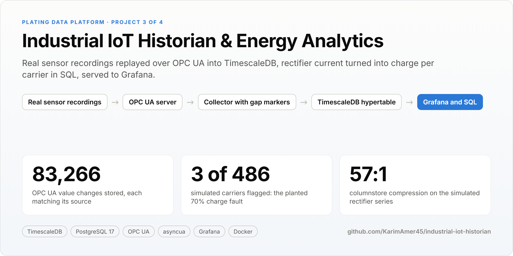
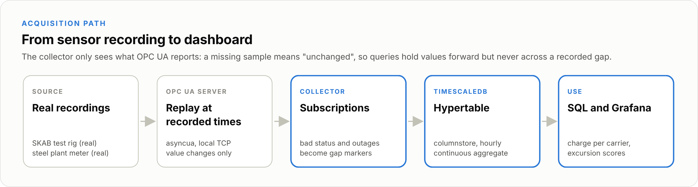
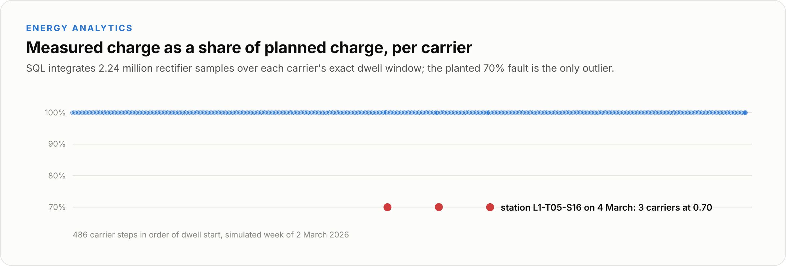
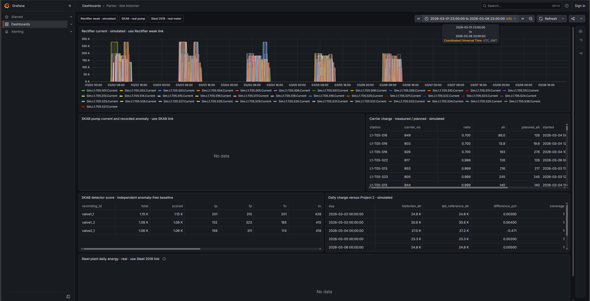
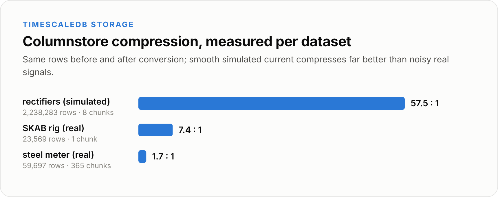

<p align="center"></p>

<p align="center"><a href="https://github.com/KarimAmer45/industrial-iot-historian/actions/workflows/verify.yml"></a>     </p>
<p align="center">Plating Data Platform: <a href="https://github.com/KarimAmer45/manufacturing-traceability">Traceability</a> &middot; <a href="https://github.com/KarimAmer45/process-quality-analytics">Lab ETL & SPC</a> &middot; <b>IoT historian</b> &middot; <a href="https://github.com/KarimAmer45/coating-specification-engine">Specification & release</a></p>

A plating line's rectifiers decide how much metal goes on each part. This project replays real sensor recordings over OPC UA into TimescaleDB, handles the gaps an industrial collector really sees, and turns rectifier current into charge per carrier in SQL, which is how a carrier that received too little current shows up.

> **Kurzfassung:** Echte Sensoraufzeichnungen (SKAB-Prüfstand, UCI-Stahlwerkszähler) werden über OPC UA in TimescaleDB abgespielt; Ausfälle und ungültige Messwerte werden als Lücken gespeichert, nicht überbrückt. Simulierte Gleichrichterströme werden je Warenträger zu Amperestunden integriert; ein absichtlich eingebauter Fehler mit 70 % Strom zeigt sich so bei genau den 3 betroffenen von 486 Warenträgern.

<p align="center"></p>

<p align="center"></p>

<p align="center"></p>

<p align="center"></p>

## Inside the database

- **OPC UA, the real way.** An asyncua server replays the recordings at their recorded times; the collector subscribes over TCP and stores only value changes, with the source timestamp in the primary key, so a repeat replay inserts nothing twice.
- **Honest gaps.** Bad status values, lost connections, queue overflow and collector stops become gap markers; the reconstruction views hold values forward but never across a gap.
- **TimescaleDB done properly.** One day chunks, columnstore segmented by signal, a conversion policy and an hourly continuous aggregate that matches all 2.3 million raw samples.
- **Energy in SQL.** Current is integrated over each carrier's exact dwell window into ampere hours and compared with the planned charge.
- **Least privilege.** Grafana reads through a dashboard role that can only see the six panels' tables and views; 42 tests on every push.

## Run it

```bash
cp .env.example .env    # set a local password
docker compose up -d db
docker compose run --rm demo
```

The demo downloads the pinned SKAB and UCI Steel files, runs the OPC UA replay and writes the evidence to `docs/results/`. Grafana and the native Windows setup are in the [report](REPORT.md).

## Data

SKAB (a water circulation test rig) and the UCI Steel Industry meter are **real** public recordings; the rectifier currents and carrier schedule are **simulated**. SKAB's pump current is never relabeled as a rectifier.

---

**Full technical report:** [REPORT.md](REPORT.md) has every result table, the evidence file behind each number, how each part is run and the known limitations.

Built by [Karim Amer](https://github.com/KarimAmer45), M.Sc. Mobile Robotics student at the University of Bonn.
